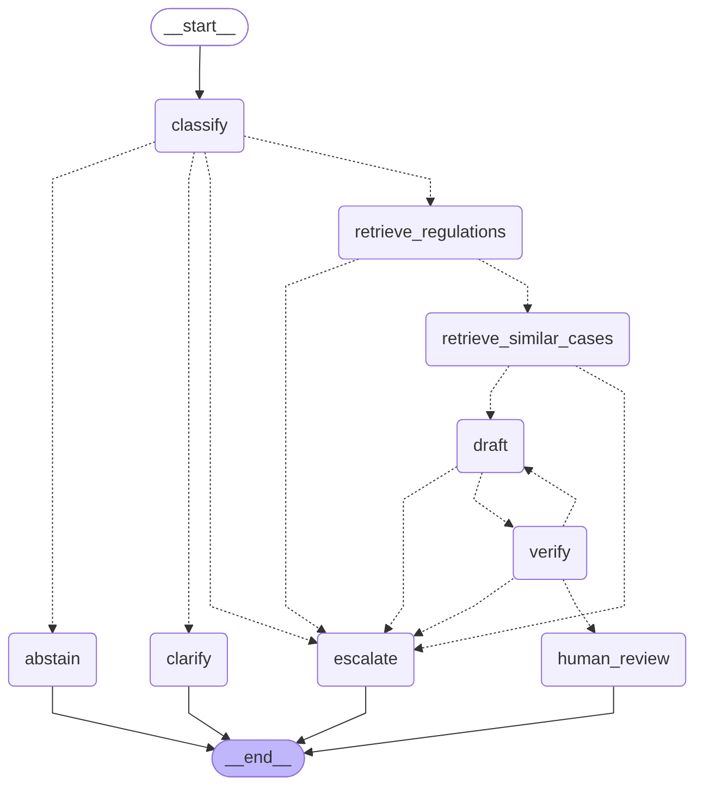
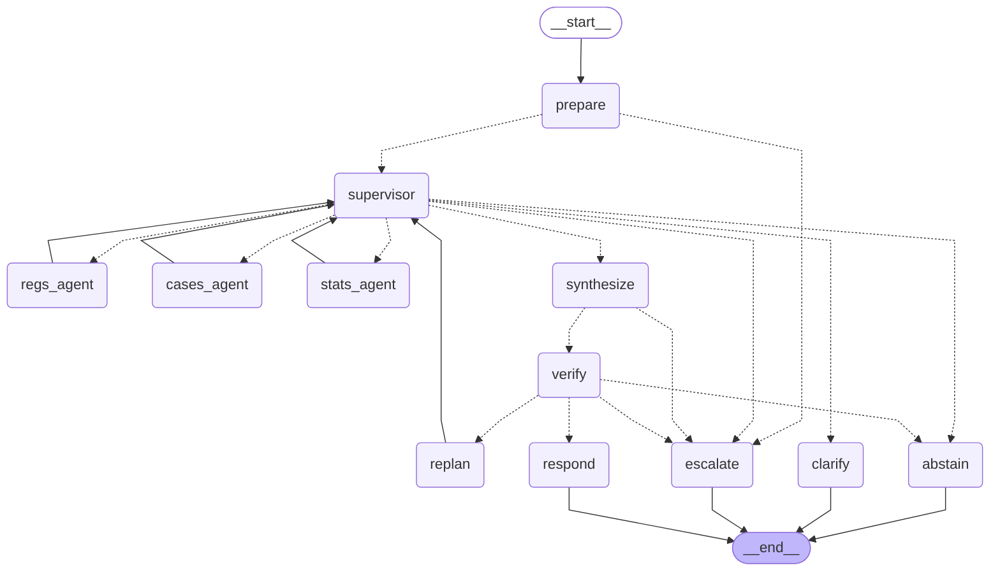

# CFPB complaint triage: multi-agent RAG

A LangGraph multi-agent system for a bank's complaint team. It triages consumer
complaints against Regulation E, F and Z, drafts cited replies, verifies every claim
against its sources, and answers analyst questions by routing between regulation
search, similar-complaint search and SQL statistics.



## Quick start
```bash
docker compose up -d                                  # Postgres 16 + pgvector
python -m venv .venv && source .venv/bin/activate
pip install -r requirements.txt
cp .env.example .env                                  # add ANTHROPIC_API_KEY, OPENAI_API_KEY

python -m pytest -q tests                             # 38 tests; DB tests need step 1
python -m ingest.run --dry-run                        # fetch + chunk only, no cost
python -m ingest.run --complaints-csv data/raw/cfpb_archive   # embed + load (see Data below)
python preflight.py                                   # checks keys, models, data, retrieval

python cli.py ask "How often can a debt collector call?"
python cli.py triage --sample --approve
streamlit run app.py
python -m eval.harness --repeats 3
python -m experiments.context_compare
```

## How it fits together
```
config.py            models, prices, thresholds, stopping conditions
runtime.py           Claude clients (2 tiers) + call ledger (tokens, latency, cost)
context.py           evidence packing under a token budget; history summary vs full
retrieval/store.py   pgvector search (HNSW, cosine, metadata filters), read-only SQL
skills/              classify, retrieve, stats, draft, verify (shared by both graphs)
graphs/static.py     fixed triage pipeline
graphs/dynamic.py    supervisor-routed analyst workflow + policy guardrails
graphs/runner.py     run_static / resume_static / run_dynamic -> one result format
eval/                cases.yaml (28 cases), harness.py (metrics + markdown report)
experiments/         context_compare.py (lean vs rich on one query)
app.py, cli.py       demo interfaces
preflight.py         setup checker
ingest/, db/         data pipeline and schema
docs/                graph diagrams, presentation notes
```

## Skills (reusable, framework-agnostic functions)
| Skill | Uses | Input → output |
|---|---|---|
| `classify` | Claude fast tier | complaint → product, issue, regulation parts, priority, scope, clarity |
| `retrieve_regulations` | pgvector | query (+ part filter) → cited chunks + best score + sufficiency |
| `retrieve_cases` | pgvector | text (+ product filter) → similar real complaints |
| `run_stats` | Postgres | structured `StatsRequest` → aggregate table (whitelisted SQL, read-only) |
| `draft` | Claude strong tier | request + packed evidence → response with per-claim citations |
| `verify` | rules + Claude strong tier | draft → supported/unsupported claims, policy issues, feedback |

## Workflows
**Static (complaint triage):** classify → retrieve regulations → retrieve similar cases →
draft → verify → human approval. Guardrail exits: out of scope → abstain; unclear →
clarify; best regulation score below the floor → escalate; verification fails 3 times
(1 draft + 2 redrafts) → escalate; any node error → escalate.

**Dynamic (analyst Q&A):** a supervisor picks the next action from the question and from
what earlier steps returned: search regulations, search complaints, run stats, synthesize,
clarify or abstain. A deterministic policy layer overrides it: 6-step cap, repeated
identical search → synthesize, synthesize with no evidence → search or abstain, 2
consecutive tool errors → escalate. After synthesis, failed verification sends feedback
back to the supervisor once (re-plan), then abstains or escalates.



## Hallucination handling
1. **Grounded drafting:** evidence only, an ID after every claim, `insufficient_evidence` flag.
2. **Deterministic checks:** every claim cited, every cited ID was actually in context, no
   promised refunds or outcomes.
3. **LLM judge:** each claim is checked against the text of the evidence it cites (catches a
   real citation attached to a wrong deadline).
4. **Act on failure:** redraft with feedback, re-plan, abstain, or escalate to a human.
5. **Prompt injection:** customer text is wrapped and marked untrusted; eval cases test it.

## Configuration notes
- **Models:** `claude-haiku-5-5` (classify, route, summarize) and `claude-sonnet-5-5` (draft,
  verify). Override with `FAST_MODEL` / `STRONG_MODEL`.
- **Temperature:** Claude Haiku 5.5 and Sonnet 5.5 don't accept a custom temperature, so both run
  at their defaults; run-to-run variation is measured with `eval.harness --repeats`.
- **Prices** in `config.py` are placeholders; confirm them on the providers' pricing pages
  before quoting costs.
- **Score floor** (`REG_MIN_SCORE`, default 0.30) must be calibrated on your data; the eval
  report includes a calibration section.

## Data design decisions
**Regulations (12 CFR 1005, 1006, 1026):** section-aligned chunks (never cross a section),
paragraphs packed to 700 tokens, a contextual header on every chunk, citations down to
top-level paragraphs (`12 CFR 1026.13(a)-(b)`), and the eCFR issue date on every row.

**Complaints:** consented narratives only; CFPB `XXXX` redactions normalised; under-30-word
and duplicate narratives dropped; long ones truncated; typed SQL columns so stats run in SQL.
**Data source change (August 2026):** the CFPB stopped publishing complaint narratives on
2026-08-14, so the live API and current bulk download no longer include them. Use the CFPB's
official [narratives archive](https://www.consumerfinance.gov/foia-requests/foia-electronic-reading-room/cfpb-consumer-complaint-database-narratives-archive/):
download a few recent `CCDB_Export_*.zip` files into `data/raw/cfpb_archive/` and run
`python -m ingest.run --only complaints --complaints-csv data/raw/cfpb_archive`. ZIPs are read
directly; overlapping periods are de-duplicated. The sample is therefore frozen at
August 2026, which is a stated limitation.

## Known limitations
- Official Interpretations (Reg Z Supplement I) and other regulations (Reg DD, FCRA) are not
  ingested; the eval includes a case that fails because of this.
- Complaint narratives are consumer-reported and unverified; the sample is not the whole market.
- The LLM judge shares a model family with the drafter; a human reviewer remains the final gate.
- `reg_hint` and product mapping are heuristics, not legal determinations.
